  

<!-- BADGE:START --><!-- BADGE:END -->

<!-- AVAILABILITY: edit the line below, then delete this comment's opening and closing markers to show it.

<b>📍 Based in YOUR CITY, Kenya</b> · 🟢 Open to roles in AI evaluation, data quality and analytics

-->

## 🧪 Evaluation report

| Criterion | Verdict | Evidence |
|:--|:--:|:--|
| Measures rater agreement | ✅ | Cohen's kappa, exact agreement and overturn rate across independent scorers in `rubricops` |
| Knows when an AI judge is biased | ✅ | Position and verbosity bias against ~3,300 MT-Bench expert votes in `judgecheck` |
| Audits training labels | ✅ | Flags contradictions, duplicate rationales and speed anomalies — with evidence for each — in `labellint` |
| Doesn't let AI invent sources | ✅ | Every quote checked against the source page in `reference-based-revision-tool`; only real Crossref/OpenAlex records in `citewise-ai` |
| Tests before shipping | ✅ | 92 tests + CI in `judgecheck` · 97% coverage in `labellint` · Playwright browser tests in `rubricops` |
| Builds things that actually run | ✅ | <!-- COUNT:START -->10<!-- COUNT:END --> public projects, including single-binary Go apps with no setup |
| Currently leveling up | 🔄 | `patchbench`: SWE-bench-style patch evaluation in isolated Docker containers |

## ⚡ Projects

  <b>🧪 Evaluation:</b>
  <a href="https://github.com/judie-paul/rubricops">RubricOps</a> ·
  <a href="https://github.com/judie-paul/judgecheck">JudgeCheck</a> ·
  <a href="https://github.com/judie-paul/labellint">LabelLint</a> ·
  <a href="https://github.com/judie-paul/patchbench">PatchBench</a>

  <b>📚 Grounded AI:</b>
  <a href="https://github.com/judie-paul/reference-based-revision-tool">Revision Tool</a> ·
  <a href="https://github.com/judie-paul/citewise-ai">CiteWise AI</a> ·
  <a href="https://github.com/judie-paul/github-resume-generator">GitHub → Resume</a>

  <b>🛠️ Web apps:</b>
  <a href="https://github.com/judie-paul/shoebox">Shoebox</a> ·
  <a href="https://github.com/judie-paul/school-management-system">School Management</a> ·
  <a href="https://github.com/judie-paul/contractor-application">Contractor Application</a>

## 🧰 Toolbox

  

## 🐍 Activity

<picture>
  <source media="(prefers-color-scheme: dark)" srcset="https://raw.githubusercontent.com/judie-paul/judie-paul/output/calendar-dark.svg">
  
</picture>

<picture>
  <source media="(prefers-color-scheme: dark)" srcset="https://raw.githubusercontent.com/judie-paul/judie-paul/output/github-snake-dark.svg" />
  <source media="(prefers-color-scheme: light)" srcset="https://raw.githubusercontent.com/judie-paul/judie-paul/output/github-snake.svg" />
  
</picture>

## 📡 Reach me

<!-- LINKEDIN: replace YOUR_LINKEDIN, then delete this comment's opening and closing markers to show it.

-->

